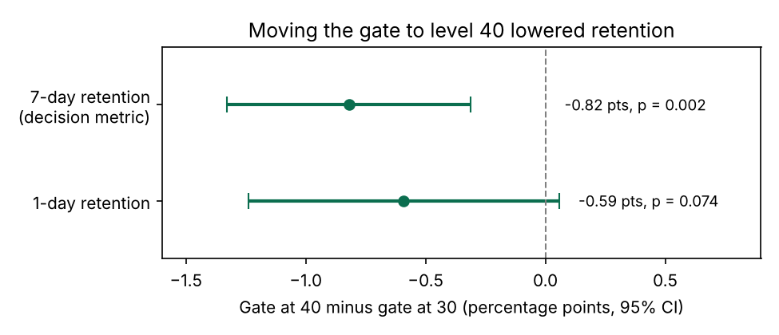
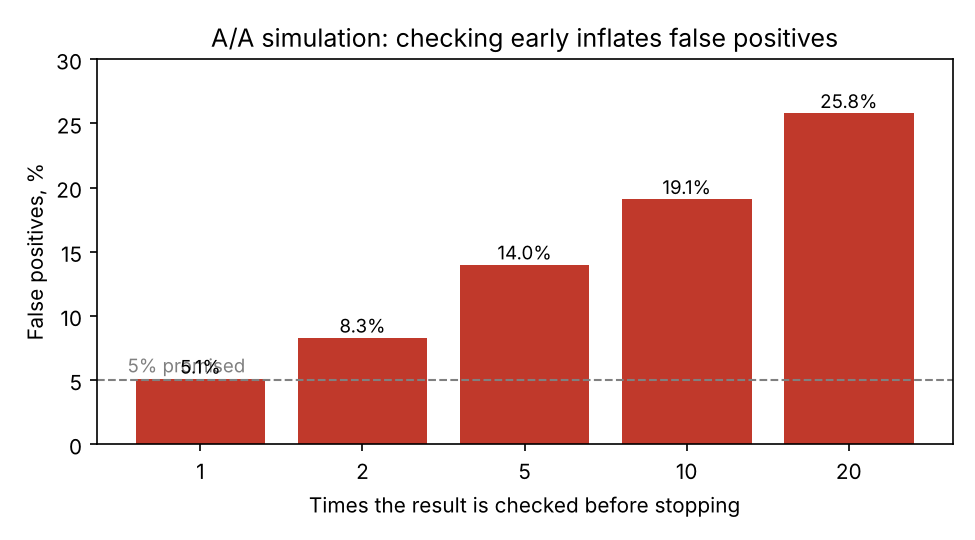

# A/B Test: Does Moving a Game's First Gate Hurt Retention?

[](https://github.com/OmkarG-Star/ab-testing-game-retention/actions/workflows/ci.yml)

**Live calculator: [ab-test-calculator-rmke.onrender.com](https://ab-test-calculator-rmke.onrender.com)**. Check your own test for traffic-split problems, significance and the probability B beats A, or plan the sample size for a new one. Free hosting, so the first load can take about a minute.

Analysis of a real experiment on 90,189 players of the mobile game *Cookie Cats*. The first "gate", where players must wait or pay to continue, was moved from level 30 to level 40.

**Decision: keep the gate at level 30.** Moving it to 40 lowered 7-day retention by **0.82 percentage points** (19.02% → 18.20%, 95% CI −1.33 to −0.31, p = 0.002). That conclusion holds after correcting for three metrics, and after a worst-case allowance for the flawed traffic split described below.



## The experiment

| | Gate at level 30 (control) | Gate at level 40 (treatment) |
|---|---|---|
| Players | 44,700 | 45,489 |
| 1-day retention | 44.82% | 44.23% |
| **7-day retention (decision metric)** | **19.02%** | **18.20%** |
| Median game rounds in first 14 days | 17 | 16 |

Players were randomly assigned at install. Each player appears once (90,189 unique IDs). Data source: Tactile Entertainment's experiment, as published in DataCamp's *Mobile Games A/B Testing* project. `scripts/get_data.py` downloads it and checks the file's hash.

7-day retention is the decision metric because the gate's purpose is to keep players coming back over days, and next-day retention can't show that.

## Step 1: check the split before reading any result

The test was planned as 50/50, but the treatment group has **789 more players**. A chi-square sample ratio mismatch (SRM) test gives **p = 0.009**: a fair 50/50 split produces an imbalance this large less than 1% of the time.

| Players | Share in control | SRM p-value |
|---|---|---|
| All | 49.56% | **0.009** |
| Played at least one round | 49.61% | 0.023 |
| Installed but never played | 48.50% | 0.058 |

The imbalance shows up in players who played and in those who never did, so it isn't explained by one obvious group. In a real team this would go back to engineering to check assignment and logging. Here the logs don't exist, so step 4 tests whether the conclusion could be an artefact of the mismatch.

## Step 2: what could this sample detect?

With 44,700 players per arm, 80% power and α = 0.05:

- **7-day retention:** smallest detectable drop is **0.74 points**. The observed drop of 0.82 is only just above that, so the true effect may be smaller than measured (the "winner's curse"). The direction is reliable; the exact size is not.
- **1-day retention:** smallest detectable drop is 0.93 points. Detecting the observed 0.59-point drop would take about **107,700 players per arm**, so the inconclusive 1-day result is a power problem, not evidence of no effect.

## Step 3: results, corrected for testing three metrics

| Metric | Difference (40 − 30) | 95% CI | p-value | Holm-adjusted p |
|---|---|---|---|---|
| **7-day retention** | **−0.82 pts (−4.3%)** | **−1.33 to −0.31** | **0.002** | **0.005** |
| 1-day retention | −0.59 pts (−1.3%) | −1.24 to +0.06 | 0.074 | 0.100 |
| Game rounds (Mann-Whitney) | median 17 → 16 | — | 0.050 | 0.100 |

- **Game rounds** are heavily skewed, so they're compared with a rank test rather than a t-test. One control player logged 49,854 rounds against a median of 16; with that player removed, the mean difference is −0.04 rounds (bootstrap 95% CI −1.36 to +1.26).
- **Bayesian check:** with flat priors, the probability that the level-40 gate has *higher* 7-day retention is **0.08%**.

## Step 4: does the conclusion survive the traffic imbalance?

The treatment group has 394 more players than a perfect 50/50 split would give. If those extra players are the problem, the most damaging case is that every one of them was a non-returner who inflated the treatment group's denominator.

| Assumption about the 394 surplus players | 7-day difference | 95% CI | p-value |
|---|---|---|---|
| As observed | −0.82 pts | −1.33 to −0.31 | 0.002 |
| All were non-returners (worst case for the conclusion) | −0.66 pts | −1.17 to −0.15 | 0.011 |
| All were returners | −1.53 pts | −2.04 to −1.03 | < 0.001 |

Even under the worst case, the level-40 gate still lowers 7-day retention significantly. The mismatch weakens confidence in the exact size but doesn't change the decision.

## Why the stopping rule matters



This chart is a **simulation**, not part of the Cookie Cats data. It runs 1,000 A/A tests per bar, with both groups identical at 19% retention and 44,700 players each, and counts how often a test is wrongly declared significant. Checking once keeps the promised 5% error rate. Checking 20 times and stopping at the first significant result raises it to 26%. The Cookie Cats result is analysed once, at the full sample, which is why its p-value can be taken at face value.

## Limitations

- **Cause of the traffic imbalance is unknown.** Step 4 bounds its effect but can't rule out a bug that also changed who was in each group.
- **Retention only.** The gate can be skipped by paying, so moving it may change revenue in either direction. The decision assumes retention matters more than short-term purchases.
- **Seven days.** Longer-term retention isn't in the data.
- **Effect size uncertain.** The observed drop is close to the smallest detectable effect, so the real drop may be smaller.

## Run it

```bash
pip install -r requirements.txt
python scripts/get_data.py
PYTHONPATH=src python -m abtest.analysis   # writes reports/results.json and figures
pytest
streamlit run app/streamlit_app.py
```

```
src/abtest/stats.py      SRM test, z-test with CI, MDE and sample size, Holm, bootstrap,
                         Bayesian probability, A/A peeking simulation
src/abtest/analysis.py   the four steps above, in order
tests/test_stats.py      checks against statsmodels and known properties
app/streamlit_app.py     the live calculator, built on the same tested functions
```
